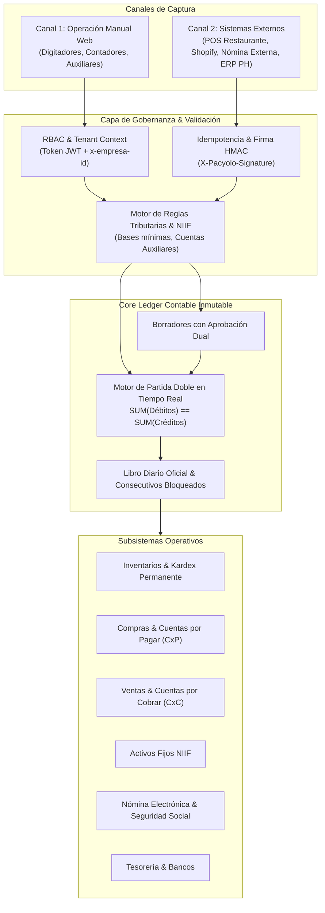
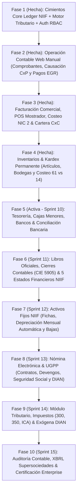

# 🧭 PACYOLO: Arquitectura Maestra del Core ERP Contable Universal
## Sistema Contable, Tributario y Operativo Multi-Industria (Colombia NIIF / DUR 2420)

---

### 1. 🎯 Visión y Premisa Fundamental

**PACYOLO** no es un software contable genérico ni un simple visor de transacciones. Es un **Universal Accounting Core & ERP** diseñado para operar con la misma solidez técnica y normativa en:
- 🍞 **Una Panadería o Restaurante:** Materia prima (harina, carnes), recetas/transformación (inventario en proceso), producto terminado (pan, platos) y punto de venta ágil con propinas e impuesto al consumo (INC 8%).
- 🏍️ **Un Almacén y Taller de Motos/Comercio:** Compra y venta de mercancía no fabricada por la empresa (Grupo 14), control unitario y serializado de chasis/motor (VIN), SKU de repuestos, valuación Promedio Ponderado y costeo de ventas automático en cada salida.
- 🏢 **Una Empresa de Servicios / Propiedad Horizontal / Consultoría:** Honorarios, causaciones directas al gasto, manejo de presupuestos y gestión de cartera.
- 🏭 **Pequeña y Mediana Industria:** Costos directos de mano de obra, CIF (costos indirectos) y costeo de producción.

---

### 2. ⚡ El Principio de Operación Dual: "Propio + Integración Externa"

El sistema debe operar siempre bajo una arquitectura de **Doble Canal de Entrada**:

1. **Canal Manual (Frontend Web Autónomo):**  
   El contador o auxiliar se sienta en la aplicación web, abre un formulario y digita asientos, causa facturas de compras con retenciones automáticas, registra pagos o emite comprobantes.
2. **Canal Integrado (API-First / Webhooks):**  
   Un software de facturación POS (ej: el POS del restaurante), una tienda virtual (Shopify/WooCommerce) o una pasarela de pagos (Wompi/Stripe) envía transacciones en JSON. PACYOLO las recibe con idempotencia criptográfica y las contabiliza de inmediato o las deposita en bandeja de borradores para revisión.

---

### 3. 🧩 Desglose Exhaustivo de los Módulos del Sistema

---

#### MÓDULO 1: Core Ledger & Catálogo Contable (Ya Construido 100%)
- **PUC NIIF Colombia (5 niveles):** Clase, Grupo, Cuenta, Subcuenta y Auxiliar. Validación estricta que impide imputar a cuentas no auxiliares.
- **Motor de Partida Doble:** Validación matemática en memoria y base de datos antes de persistir (`SUM(D) == SUM(C)`).
- **Tipología de Comprobantes Oficiales:** `DIA` (Diario), `ING` (Ingreso/Recaudo), `EGR` (Egreso/Pago), `CAU` (Causación de Compras), `APE` (Apertura), `CIE` (Cierre).
- **Inmutabilidad y Consecutivos:** Control pesimista por tenant para evitar huecos en la numeración legal. Anulaciones exclusivamente mediante **reversión NIIF / contra-asiento**.

---

#### MÓDULO 2: Terceros, Tributario & Cuentas por Pagar (CxP) (Ya Construido 100%)
- **Directorio de Terceros:** Cédulas y NITs con validación matemática de Dígito de Verificación (Dian Módulo 11).
- **Motor Tributario Nacional y Territorial:**
  - Retefuente por compras (2.5%), servicios (4%), honorarios (10%/11%).
  - ReteICA territorial parametrizable por municipio.
  - ReteIVA (15%) e IVA descontable (Cuenta 240802).
  - Impuesto Nacional al Consumo (INC 8% para restaurantes y bares).
- **Causación de Compras:** Registro de pasivos (Cuentas del Grupo 22 y 23) y comprobante `CAU`.
- **Comprobantes de Egreso (`EGR`):** Cancelación de deudas con afectación a bancos/caja y comprobante oficial.

---

#### MÓDULO 3: Facturación Comercial, Electrónica & Cuentas por Cobrar (CxC)
> *Generación propia de facturas y recepción desde sistemas externos, control de cartera y recaudos.*

- **Facturación Propia (Emisión Directa desde PACYOLO):**
  - **Factura Electrónica de Venta (DIAN Anexo 1.9):**
    - Prefijos y rangos de numeración autorizados por la DIAN (ej: `SETP-1000` a `5000`).
    - Generación de CUFE (Código Único de Factura Electrónica) y Código QR.
    - Representación gráfica en PDF oficial con desglose de impuestos y discriminación de ítems.
  - **Facturación POS / Tiras de Caja (Para Restaurantes, Panaderías y Mostrador):**
    - Venta rápida al contado o a crédito.
    - Manejo de propinas voluntarias (pasivo de distribución).
    - Descuentos comerciales condicionados y a pie de factura.
  - **Recepción / Ingesta de Facturas Externas (Doble Canal):**
    - Ingesta desde e-commerce (Shopify, WooCommerce) o POS externos vía API con idempotencia estricta.
- **Impuestos en Venta:**
  - IVA Generado (Tarifas 0%, 5%, 19% - Cuenta 240805).
  - Impuesto Nacional al Consumo (INC 8% para restaurantes y bares - Cuenta 2495).
  - Retenciones que le practican al negocio (Anticipo de Retefuente 135515, Anticipo de ReteICA 135518, Anticipo de ReteIVA 135517).
- **Gestión de Cartera & Recaudos (`ING`):**
  - Cuentas por Cobrar Clientes (Cuenta 1305).
  - Recibos de caja / Comprobantes de ingreso cruzando saldos totales o abonos parciales.
  - Estado de cuenta de clientes y reporte de antigüedad de cartera (corriente, 30, 60, 90, 180+ días).

---

#### MÓDULO 4: Tesorería, Flujo de Caja & Conciliación Bancaria
> *El control milimétrico del dinero real: efectivo en caja y cuentas bancarias.*

- **Catálogo de Cajas y Cuentas Bancarias:**
  - Cajas Principales y Cajas Menores con fondo fijo y arqueos de caja periódicos.
  - Cuentas Bancarias (Corrientes y de Ahorros) vinculadas a sus respectivas cuentas auxiliares NIIF (111005, 111010).
- **Operaciones de Tesorería:**
  - **Traslados de Fondos:** Movimientos entre caja y bancos o entre cuentas bancarias (sin afectar pérdidas y ganancias).
  - **Reembolso y Legalización de Caja Menor:** Comprobante de gastos menores con soporte de terceros y retenciones aplicadas.
  - **Control de Cheques y Transferencias:** Cheques girados y no cobrados, transferencias electrónicas pendientes.
- **Conciliación Bancaria Automática y Asistida:**
  - Importación de extractos bancarios oficiales (formatos Excel, CSV o texto plano bancario estándar: Bancolombia, Davivienda, BBVA, etc.).
  - Motor de cruce automático: Coincidencia por fecha, valor y número de referencia/comprobante.
  - Partidas conciliatorias: Identificación de notas débito (comisiones bancarias, 4x1000 GMF - Cuenta 5115), notas crédito (intereses ganados) y cheques en tránsito.
- **Proyección de Flujo de Caja:** Flujo de caja real vs presupuestado a 30, 60 y 90 días basado en los vencimientos de CxP y CxC.

---

#### MÓDULO 5: Autenticación, Tenancy & Control de Acceso RBAC (Ya Construido 100%)
- Entidades `core_usuarios` y `core_usuarios_empresas` (Relación $N:M$ con rol por tenant).
- Hashing criptográfico con `bcrypt` (salt 10+). Tokens JWT firmados con contexto multi-tenant.
- Roles nativos: `SUPER_ADMIN`, `ADMIN_EMPRESA`, `CONTADOR_LIDER`, `AUXILIAR_CONTABLE`, `AUDITOR_CONSULTA`.
- Protección contextual con `@Roles()` y `RolesGuard` evaluando `x-empresa-id`.

---

#### MÓDULO 6: Catálogo de Ítems, Inventarios & Kardex Paramétrico Universal (NIC 2 / DUR 2420)
> *Modelo agnóstico y flexible que se adapta a cualquier actividad económica (comercio, servicios, manufactura, retail).*

- **Tipología Universal de Ítems / Catálogo:**
  - `SERVICIO` (Sin inventario físico: corte de cabello, asesoría contable, mano de obra mecánica, transporte). Imputación directa: Venta `4155/4170` vs Costo directo `6155` o gasto.
  - `PRODUCTO_SIMPLE` (Venta unitaria por código o código de barras: cuadernos, bolígrafos, herramientas, lubricantes). Cuenta `1435`.
  - `PRODUCTO_FRACCIONABLE_GRANEL` (Venta por peso, longitud o volumen: carnicería por kilos/libras, ferretería por metros de cable, tornillos por libra, telas).
  - `MATERIA_PRIMA_TRANSFORMACION` (Ingredientes o insumos que se consumen para producir: harina, azúcar, carne cruda, pintura). Cuenta `1405`.
  - `PRODUCTO_TERMINADO` (El resultado de la transformación: tortas, platos preparados, muebles armados). Cuenta `1430`.
  - `PRODUCTO_SERIALIZADO` (Trazabilidad única por unidad: electrodomésticos, maquinaria, motos, celulares con IMEI/Serial).
  - `PRODUCTO_PERECEDERO_LOTE` (Control de fechas de caducidad y lotes: carnes, lácteos, medicamentos, alimentos).
- **Atributos Parametrizables por Tenant / Industria:**
  - **Unidades de Medida:** Unidad (`UND`), Kilogramo (`KG`), Gramo (`GR`), Metro (`MTR`), Litro (`LTR`), Galón (`GL`), Caja (`CJ`), Hora de Servicio (`HRS`).
  - **Conversión de Unidades:** Comprar en bulto de 50 kg y vender por libras/kilos; comprar rollo de 100 m y vender por metros.
  - **Reglas Tributarias por Ítem:**
    - Tarifa de IVA asociada: Excluido, Exento (0%), 5%, 19%.
    - Impuesto Nacional al Consumo (INC 8% para restaurantes y cafeterías).
- **Kardex Permanente Valorado:**
  - Valuación automática bajo norma legal: **Promedio Ponderado** o **PEPS (FIFO)**.
  - Entradas por compras a proveedores, salidas automáticas por facturación de venta, mermas/desperdicios justificados y traslados entre bodegas/sucursales.
  - **Asiento Automático de Costo:**
    $$\text{Débito 61 (Costo de Ventas)} \quad \longleftrightarrow \quad \text{Crédito 14 (Salida de Inventarios)}$$
    *(Si el ítem es de tipo `SERVICIO`, no afecta inventario físico y no mueve la cuenta 14).*

---

#### MÓDULO 7: Nómina Electrónica & Seguridad Social (DIAN / UGPP)
> *Con todos los fierros para la legislación laboral colombiana.*

- **Contratos Laborales:** Término fijo, indefinido, obra o labor, aprendizaje Sena.
- **Estructura Salarial:** Salario básico, Auxilio de transporte legal, horas extras (diurnas, nocturnas, festivas), recargos, comisiones y bonificaciones salariales/no salariales.
- **Deducciones de Ley:** Salud (4%), Pensión (4%), Fondo de Solidaridad Pensional (1%-2%), Retención en la fuente por salarios (Procedimiento 1 / 2), préstamos y embargos.
- **Aportes Patronales (Seguridad Social & Parafiscales):** Salud patronal (exoneración Art. 114-1 E.T.), Pensión patronal (12%), ARL (Riesgos I a V), SENA, ICBF, Caja de Compensación (4%).
- **Provisiones Prestacionales NIIF:** Cesantías (8.33%), Intereses sobre cesantías (1%), Prima de servicios (8.33%), Vacaciones (4.17%).
- **Contabilización Automática del Devengo y Pago:**
  - Débito a Gastos de Personal (5105 / 5205 / 7205 Mano de obra directa en panadería).
  - Crédito a Salarios por pagar (2505), Seguridad Social por pagar (2370) y Retenciones de nómina (236505).
- **Emisión de XML Nómina Electrónica:** Generación del CUNE y transmisión a la DIAN.

---

#### MÓDULO 8: Activos Fijos & Propiedad, Planta y Equipo (NIC 16 / NIIF)
> *Control patrimonial con depreciación, deterioro y mantenimiento.*

- **Ficha Técnica del Activo:**
  - Código de placa / código de barras.
  - Fecha de adquisición, proveedor y factura de compra.
  - Centro de costos, ubicación física y responsable asignado.
  - Valor de adquisición, Valor residual / de salvamento y Vida útil estimada (en meses o unidades de producción).
- **Categorías NIIF:**
  - Terrenos (no depreciables).
  - Edificaciones y locales.
  - Maquinaria y equipo (hornos de panadería, rampas de taller de motos).
  - Equipo de computación y comunicación.
  - Flota y equipo de transporte.
- **Motor de Depreciación Automática Mensual:**
  - Métodos: Línea recta, suma de dígitos o unidades producidas.
  - Proceso de cierre mensual automático:
    $$\text{Débito 5160 / 5260 (Gasto Depreciación)} \quad \longleftrightarrow \quad \text{Crédito 1592 (Depreciación Acumulada)}$$
- **Baja y Venta de Activos Fijos:**
  - Cálculo de la utilidad o pérdida en venta de activo fijo (comparando valor en libros vs precio de venta).
  - Retiro por obsolescencia o daño irreparable.

---

#### MÓDULO 9: Libros Oficiales Registrados, Cierres Contables & Los 5 Estados Financieros NIIF (DUR 2420 / NIC 1)
- **Cierre y Bloqueo de Períodos Mensuales (Candado Contable):**
  - Congelamiento formal y auditado de fechas contables para impedir modificaciones o inserciones extemporáneas en períodos ya declarados o presentados a gerencia.
- **Motor de Cierre Anual NIIF (Comprobante `CIE` al 31 de Diciembre):**
  - Cancelación automática de todas las cuentas nominales de resultado (Clase 4 Débito, Clases 5, 6 y 7 Crédito) contra la cuenta intermedia `590505 Ganancias y Pérdidas`.
  - Traslado del saldo neto al Patrimonio: Débito `5905` <-> Crédito `360505 Utilidad del Ejercicio` (o Débito `361005 Pérdida` <-> Crédito `5905`).
  - Traslado automático de saldos de balance (1, 2, 3) como saldos iniciales del año siguiente.
- **Diferencia en Cambio NIIF (NIC 21):**
  - Reexpresión mensual de activos y pasivos en moneda extranjera según la TRM oficial de la Superfinanciera (`530525` vs `421020`).
- **Árbol Jerárquico Multinivel del PUC:**
  - Selector dinámico de profundidad en Balances con drill-down interactivo: Nivel 1 (Clase 1 dígito), Nivel 2 (Grupo 2 dígitos), Nivel 3 (Cuenta 4 dígitos), Nivel 4 (Subcuenta 6 dígitos) y Nivel 5 (Auxiliar de detalle a 8-10 dígitos).
- **Los 5 Estados Financieros Oficiales NIIF (NIC 1 / NIC 7 / Sección 3 NIIF Pymes):**
  1. **Estado de Situación Financiera:** Clasificado en Corriente y No Corriente.
  2. **Estado de Resultado Integral (ERI):** Desglose de P&G operativo y Otro Resultado Integral (ORI).
  3. **Estado de Cambios en el Patrimonio:** Conciliación de capital social, reservas y utilidades.
  4. **Estado de Flujos de Efectivo (NIC 7):** Flujos por actividades de Operación, Inversión y Financiación bajo métodos Directo e Indirecto.
  5. **Notas y Revelaciones a los Estados Financieros:** Resumen de políticas y desagregaciones analíticas.
- **Libros Oficiales Registrados (Código de Comercio y Revisoría Fiscal):**
  - Libro Mayor y Balances mensual.
  - Libro Diario Columnario mensual por tipo de comprobante.
  - Libro de Inventarios y Balances anual.
  - Libro Auxiliar Integral por Cuenta Contable y Tercero (NIT).

---

#### MÓDULO 10: Módulo Tributario, Liquidación de Impuestos & Información Exógena DIAN (Medios Magnéticos)
- **Mapeo de PUC a Conceptos DIAN:** Configuración de cuentas auxiliares hacia los conceptos de exógena nacional.
- **Borradores de Declaraciones Tributarias Oficiales:**
  - Formulario 300 (IVA bimestral/cuatrimestral): bases gravadas (19%, 5%), exentas, excluidas, IVA generado vs descontable.
  - Formulario 350 (Retención en la Fuente mensual): compras, servicios, honorarios, arrendamientos, salarios y autorretenciones.
  - Declaración de ICA territorial (según municipio DANE y actividades gravadas).
- **Motor de Información Exógena Nacional DIAN (Medios Magnéticos):**
  - Generación y exportación a Excel / XML validable en el prevalidador DIAN:
    - Formato 1001: Pagos o abonos en cuenta y retenciones practicadas.
    - Formato 1003: Retenciones en la fuente que le practicaron a la empresa.
    - Formato 1005 / 1006: IVA descontable e IVA generado e Impoconsumo.
    - Formato 1007: Ingresos propios recibidos en el ejercicio.
    - Formato 1008 / 1009: Saldos de Cuentas por Cobrar (CxC) y Cuentas por Pagar (CxP) a 31 de diciembre.
    - Formato 1011 / 1012: Información de declaraciones y saldos en cuentas bancarias.
    - Formato 2276: Certificado de ingresos y retenciones por rentas de trabajo (nómina).
- **Certificados Tributarios:** Certificados de retención en la fuente e IVA con firma digital para proveedores.

---

#### MÓDULO 11: Auditoría Contable, Exportación XBRL (Supersociedades) & Certificación Enterprise
- **Taxonomía XBRL Oficial:** Exportación estructurada para el software STORM / XBRL Express de la Superintendencia de Sociedades.
- **Motor de Pruebas de Consistencia de Partida Doble:** Verificación automatizada de Sumas Iguales en el 100% de los asientos históricos.
- **Certificación de Inmutabilidad:** Validación de pistas de auditoría (`aud_pistas`) e integridad de sellos temporales.

---

### 4. 🗺️ Plan Maestro de Ejecución (Fases Estratégicas)

| Fase | Alcance Central | Beneficio para el Negocio |
| :---: | :--- | :--- |
| **Fase 1 (Hecha)** | Core Ledger NIIF, Motor Tributario, Ingesta API/Webhooks, RBAC Multi-tenant y Web Base. | Cimientos arquitectónicos sólidos y seguros. |
| **Fase 2 (Hecha)** | **Operación Contable Web Manual:** Comprobantes contables con partida doble, causación de compras y pagos/egresos directamente desde el navegador. | El contador opera el 100% de la contabilidad sin depender de APIs. |
| **Fase 3 (Hecha)** | **Facturación Comercial & POS:** Facturas de venta oficiales, tiras POS con impoconsumo (INC 8%), notas crédito NIIF 15 / NIC 2 y cartera CxC con pronto pago. | Facturación oficial en panadería, almacén o servicios. |
| **Fase 4 (Hecha)** | **Inventarios & Kardex Permanente:** Catálogo universal (servicios, productos simples, materias primas), movimientos y costeo automático (61 vs 14). | Valuación NIC 2 de existencias en tiempo real. |
| **Fase 5 (Activa - Sprint 10)** | **Tesorería & Conciliación Bancaria:** Cajas menores, arqueos de efectivo, control de cuentas bancarias y motor de conciliación automática contra extractos oficiales. | Control milimétrico de la liquidez real en bancos y cajas. |
| **Fase 6 (Sprint 11)** | **Libros Oficiales, Cierres & 5 Estados Financieros NIIF:** Cierre mensual con candado, cierre anual con `CIE` (`5905`), árbol multinivel (1 a 5) y los 5 Estados Financieros (ESF, ERI, Cambios Patrimonio, Flujos NIC 7 y Notas). | Cumplimiento pleno DUR 2420, bancos, socios y revisoría fiscal. |
| **Fase 7 (Sprint 12)** | **Activos Fijos NIIF:** Ficha de activos, cálculo de depreciación mensual automática (1592 vs 5160), control de vidas útiles y bajas de bienes. | Control patrimonial de hornos, vehículos y maquinaria. |
| **Fase 8 (Sprint 13)** | **Nómina Electrónica & Seguridad Social:** Liquidación de salarios, horas extras, prestaciones sociales, aportes a EPS/Pensión/ARL y XML para la DIAN. | Liquidación y deducción legal del personal con causación contable. |
| **Fase 9 (Sprint 14)** | **Módulo Tributario & Medios Magnéticos DIAN:** Borradores de Formularios 300, 350, ICA y generador de formatos de Exógena (1001 a 1009, 2276) para el prevalidador. | Blindaje tributario total ante la DIAN y municipios. |
| **Fase 10 (Sprint 15)** | **Auditoría & Taxonomía XBRL:** Exportación a XBRL STORM Supersociedades, verificación masiva de sumas iguales y certificación de inmutabilidad. | Grado Revisoría Fiscal y reporte a entes de control. |

---

### 5. 💡 Conclusión y Alineación

Esta es la visión completa, integral y sin atajos: **un ERP contable universal que no le tiene miedo a ninguna industria** porque tiene su lógica modularizada, su partida doble matemática inquebrantable, su estricto apego al marco regulatorio NIIF / DIAN y su doble canal (humano en web + máquinas vía API).
